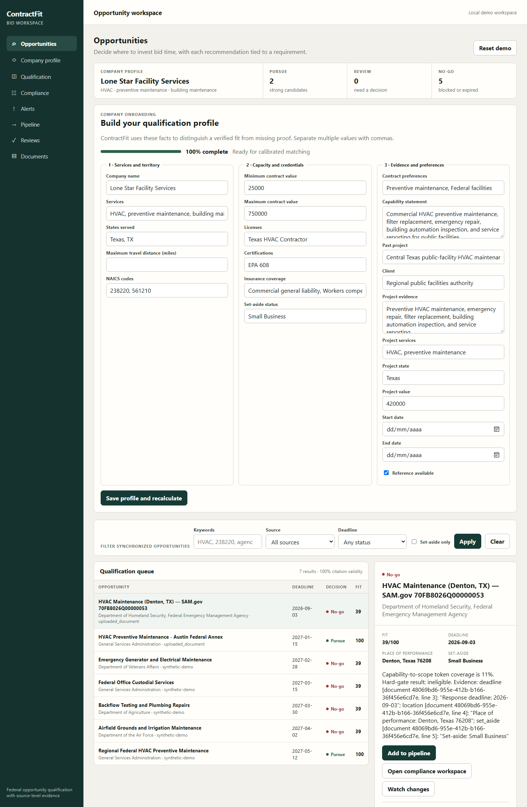
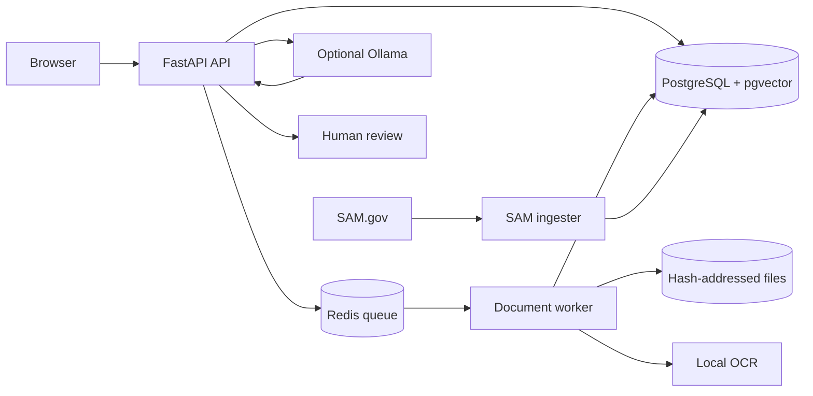

# ContractFit

[](https://github.com/adelrioj01/ContractFit/actions/workflows/ci.yml)

ContractFit is an AI-assisted workspace that helps facilities-service contractors find realistic
government opportunities, trace solicitation requirements to source evidence, and manage the work
needed for an informed bid/no-bid decision.

> Portfolio status: working vertical-slice MVP. The repository contains synthetic demonstration
> data and reproducible regression evaluations; it does not claim production accuracy or replace
> procurement or legal review.



## Why it exists

Government solicitations combine deadlines, certifications, set-asides, insurance limits,
technical requirements, amendments, and attachments. Small contractors often evaluate that
material manually and can miss a disqualifying condition or lose the evidence behind a decision.
ContractFit keeps hard eligibility rules deterministic, uses models only where semantic judgment
helps, preserves source citations, and routes uncertain results to a human reviewer.

## Product workflow

1. A contractor signs in and records capabilities, territory, capacity, certifications, and past
   performance.
2. The team imports SAM.gov opportunities or uploads PDF, DOCX, and TXT solicitations.
3. A durable worker parses files, invokes OCR when needed, and extracts evidence-linked
   requirements.
4. Deterministic gates evaluate deadlines, geography, set-asides, certifications, and capacity.
5. Optional local Ollama scoring and embeddings add semantic ranking; lexical scoring remains the
   reproducible fallback.
6. Users review ranked opportunities, resolve uncertain fields, maintain a compliance matrix, and
   compare amendments without allowing a model to make the final decision.

## What is implemented

| Capability | Status | Evidence |
|---|---|---|
| PDF, DOCX and TXT ingestion | Implemented | Hash-addressed storage, parsing and page records |
| OCR for scanned PDF pages | Implemented | Local Tesseract path with review flags |
| Requirement extraction with citations | Implemented | Deterministic extractor and labeled regression fixtures |
| Hard eligibility rules | Implemented | Deadline, territory, set-aside, certification and capacity gates |
| Semantic fit scoring | Experimental | Optional local Ollama scorer with safe lexical fallback |
| Vector retrieval | Experimental | Ollama embeddings, hash cache and pgvector cosine search |
| Human review and compliance workflow | Implemented | Organization-scoped reviews, evidence and amendment acknowledgements |
| Relevance feedback | Implemented | Organization-scoped API, persistence, dashboard controls and PostgreSQL concurrency coverage |
| SAM.gov synchronization | Implemented | Bounded ingestion, snapshots, deduplication and attachment analysis |
| Runtime autonomous agent | Not implemented | Development agents do not make product decisions |
| Hosted public demo | Not published | Local Docker workflow is documented below |

For implementation-level traceability, see [Feature status](docs/feature-status.md).

## Architecture

ContractFit is a modular monolith with separate API, worker, SAM ingestion, notification, and
persistence boundaries. PostgreSQL stores domain state, pgvector stores semantic embeddings, Redis
backs durable processing, and optional Ollama services stay behind provider interfaces.



The model never overrides deterministic eligibility gates. If Ollama fails, matching falls back to
lexical scoring and reports the method used. See [Architecture](docs/architecture.md), the
[editable diagrams](docs/diagrams/README.md), and the [technical case study](docs/case-study.md).

## Verified evaluation baseline

The following local baseline was reproduced on 2026-11-04 with the repository's synthetic fixtures:

| Evaluation | Cases | Result |
|---|---:|---:|
| Extraction and eligibility | 4 | Six recorded metrics at `1.0` |
| Deterministic instruction-text corpus | 6 | Six recorded metrics at `1.0` |
| Lexical semantic ranking | 30 | Top-1 `0.3667`, Recall@3 `0.4333`, MRR `0.5306` |

These are regression results, not customer-data accuracy claims. The corpus is intentionally small,
and latency excludes OCR, external APIs, Redis queue time, SMTP, and Ollama inference. Reproduce it:

```bash
cd backend
uv run python -m contractfit.quality_cli --output quality-report.json
uv run python -m contractfit.ranking_cli --provider lexical
```

See [Portfolio evaluation](docs/portfolio-evaluation.md) and the versioned
[evaluation artifacts](docs/evaluations/README.md).

## Run locally

### Docker path

Requirements: Docker Desktop with Docker Compose.

```bash
cp .env.example .env
docker compose up --build
```

On PowerShell, use `Copy-Item .env.example .env` for the first command. Then open
<http://localhost:8000> or check `curl http://localhost:8000/health`.

The local-only reviewer account is:

- Email: `demo@contractfit.local`
- Password: `contractfit-demo-password`

Four additional synthetic organizations are available from the login panel. Production refuses to
start with the default signing secret.

### Backend development

Requirements: Python 3.12 and [uv](https://docs.astral.sh/uv/).

```bash
cd backend
uv sync --dev
uv run ruff check .
uv run mypy src
uv run pytest
```

Direct development uses the in-memory adapter and inline processing unless configured otherwise.
Docker Compose uses PostgreSQL and separate workers.

### Optional local AI

The defaults are deterministic: `AI_PROVIDER=offline` and `EMBEDDING_PROVIDER=offline`. To exercise
local model-backed behavior, run Ollama and configure the corresponding values in `.env`:

```bash
ollama pull qwen2.5:7b
ollama pull nomic-embed-text
```

Model-backed results count as measured only when the relevant command completes successfully and
records the model and configuration used.

## Verify the portfolio build

From PowerShell at the repository root:

```powershell
./scripts/verify.ps1
```

The script runs linting, strict type checking, the full backend test suite, the portfolio quality
gate, documentation-link checks, and a tracked-file secret-pattern scan. PostgreSQL integration
checks remain part of CI because they require a migrated test database.

## Security and data boundaries

Customer-owned profiles, documents, jobs, opportunities, evidence, reviews, and compliance state
are resolved from the authenticated organization. Client-supplied ownership identifiers are not
trusted. Public SAM.gov catalog records remain shared, while analyzed attachments become private
organization-owned documents.

Do not upload customer or confidential documents to the public demo dataset. Read
[SECURITY.md](SECURITY.md) for reporting and threat-boundary information.

## Honest limitations

- Bundled evaluation data are synthetic and too small for a production-accuracy claim.
- Request logs expose trace IDs, status and local duration; centralized metrics and alerting still
  depend on the eventual hosting platform.
- The current extractor is deterministic; the instruction-text suite is not an LLM prompt-injection
  evaluation.
- Ollama scoring and embeddings are optional and have not been benchmarked across providers here.
- Excel solicitation parsing and password recovery/verification are not implemented.
- The browser UI is a dependency-light MVP served by FastAPI; the planned standalone frontend has
  not been built.
- Agent orchestration supports repository development only. ContractFit is not currently a runtime
  multi-agent product.
- ContractFit supports human decisions; it is not legal, procurement, or compliance advice.

## Documentation

- [Architecture](docs/architecture.md)
- [Feature status](docs/feature-status.md)
- [Technical case study](docs/case-study.md)
- [Portfolio evaluation](docs/portfolio-evaluation.md)
- [Development-agent workflow](docs/agent-workflow.md)
- [Roadmap](docs/roadmap.md)
- [Contributing](CONTRIBUTING.md)
- [Security](SECURITY.md)
- [Changelog](CHANGELOG.md)

## License

[MIT](LICENSE)
