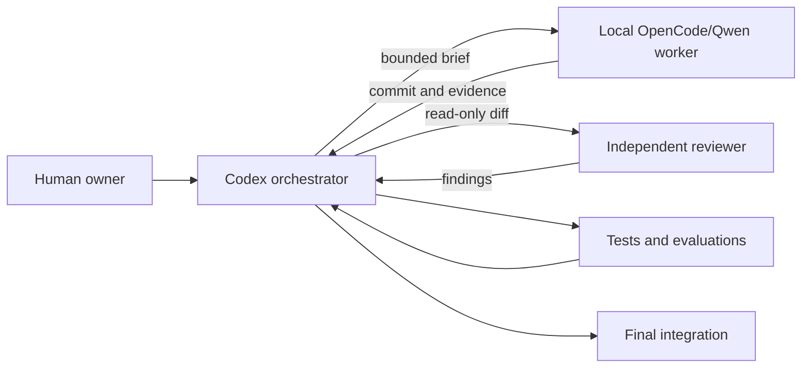

# Development-agent workflow

ContractFit uses agent orchestration to develop the repository; it does not expose autonomous
agents as a product feature. A single Codex orchestrator owns scope, architecture, integration,
verification, and the final handoff. A local OpenCode worker using `ollama/qwen2.5-coder:7b` may
implement bounded tasks in an isolated worktree, while a separate read-only reviewer reports
evidence-based findings.



## Safety boundaries

- The orchestrator retains business rules, shared schemas, security-sensitive decisions, and final
  integration.
- Workers receive allowed files, prohibited changes, acceptance criteria, and verification commands.
- Workers cannot spawn subagents, access external directories, browse the web, push, or merge.
- The reviewer cannot edit files and is never the sole acceptance authority.
- Local model output is advisory; source inspection, tests, labeled evaluations, and final diff
  review remain authoritative.
- Hosted model use requires explicit approval before private repository context is sent externally.

## Example bounded brief

```text
Objective: add tests for an existing matching fallback.
Allowed files: backend/tests/test_matching.py
Prohibited: production code, schemas, migrations, provider changes.
Acceptance: cover timeout and malformed model output; lexical fallback method is visible.
Verify: uv run pytest tests/test_matching.py; uv run ruff check tests/test_matching.py.
Handoff: changed files, observed results, limitations, local commit hash.
```

The complete policy lives in `AGENTS.md`, `docs/agent-delegation.md`, `opencode.json`, and the agent
definitions under `.opencode/agents/`.
